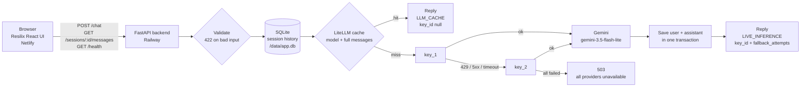
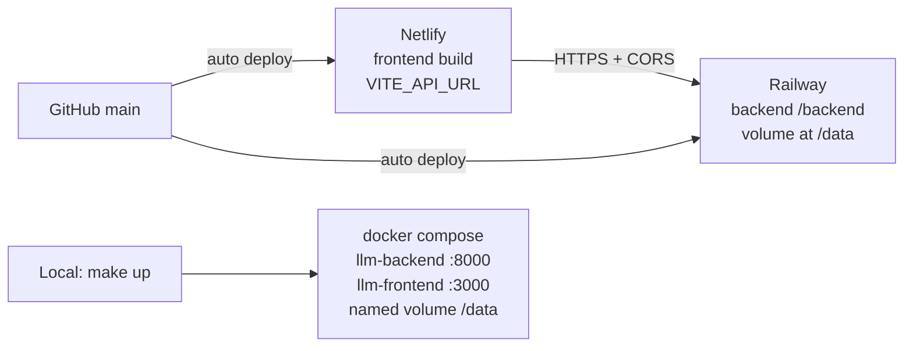

# Resilix: Resilient LLM Chat with Key Failover and Response Caching

**Reliable AI. Intelligent Recovery.**

Built for the *LLM Chatbot with Key Failover and Response Caching* assignment: a FastAPI backend tries an ordered pool of Gemini API keys, failing over on rate limits, outages and timeouts, and replays identical prompts from a response cache.
Every reply reports where it came from (`LIVE_INFERENCE` / `LLM_CACHE`), which key answered, latency and token usage; conversations persist in SQLite, and the React dashboard shows how each request recovered.

**Stack:** React + Vite (frontend) · FastAPI (backend) · LiteLLM (Gemini) · SQLite + SQLAlchemy · Docker / docker compose (nginx serves the frontend)

## 1. Live URLs

- Frontend: https://llm-resilience-chatbot.netlify.app
- Backend: https://llm-resilience-chatbot-production.up.railway.app (health: [`/health`](https://llm-resilience-chatbot-production.up.railway.app/health))
- Repository: https://github.com/shagunkimothi/llm-resilience-chatbot
- Demo video: `<VIDEO_URL>`

**Note:** the deployed backend runs with `ENABLE_FAILURE_SIMULATION=true`, so failover can be demonstrated with the `X-Simulate-Failure` header.

**Hosting:**
- The frontend is on Netlify (`frontend/netlify.toml`: base directory `frontend`, Node 22, `npm run build`, publishes `dist`, SPA fallback).
- The backend is on Railway, built from `/backend` with `backend/Dockerfile` (`backend/railway.json`, healthcheck `/health`). A Railway volume is mounted at `/data`. It holds the SQLite DB (`/data/app.db`) and the LLM cache (`/data/llm_cache`).

## 2. Run locally: with Docker and without

**Prerequisites:**
- With Docker: Docker Desktop and GNU make. On Windows without GNU make, `mingw32-make` takes the same targets, or you can run the `docker compose` commands directly.
- Without Docker: Python 3.12 and Node 22.
- At least one Gemini API key (two or more to see failover).

### With Docker

```bash
cp .env.example .env          # Windows (cmd/PowerShell): copy .env.example .env
# edit .env: LLM_API_KEYS=<key_1>,<key_2>
make up                       # = docker compose up --build -d
```

- Frontend: http://localhost:3000 · Backend: http://localhost:8000 (`/health`, `/docs`)
- `make ps`, `make logs`, `make down` (`make down` stops and removes the containers but **keeps** the volume)
- **Two containers:**
  - `llm-backend`
  - `llm-frontend`: nginx on port 3000, which starts only once the backend healthcheck passes
- **Where the data lives:** SQLite is not a container. It is the file `/data/app.db` (with the cache in `/data/llm_cache`) on the named volume `llm_appdata`, so history survives `docker compose restart` and `make down` / `make up`. `docker compose down -v` wipes it.
- `.env` is passed at runtime via `env_file`. `.dockerignore` keeps it out of both images.

### Without Docker

Backend (reads the **root** `.env`; run from `backend/`):

```bash
cp .env.example .env                 # once, at the repo root (Windows: copy .env.example .env)
cd backend
python -m venv venv
source venv/bin/activate             # Windows PowerShell: venv\Scripts\Activate.ps1   cmd: venv\Scripts\activate
pip install -r requirements-dev.txt  # runtime deps + pytest/httpx
uvicorn app.main:app --port 8000
```

Frontend (second terminal):

```bash
cd frontend
npm ci
cp .env.example .env      # optional (Windows: copy .env.example .env); sets VITE_API_URL, default http://localhost:8000
npm run dev               # http://localhost:5173
```

Without Docker, `DATABASE_URL` and `CACHE_DIR` default to `./data/app.db` and `./data/llm_cache`, relative to `backend/`. The folder is created on startup.

### Tests

```bash
make test                                  # default PY is the Windows venv path (backend/venv/Scripts/python.exe)
make test PY=backend/venv/bin/python       # macOS / Linux
```

`make test` installs `backend/requirements-dev.txt`, then runs:
- backend **pytest: 39 tests**
- frontend **Vitest + Testing Library: 46 tests**

Both suites use mocks, so they need no API key or network.

### Environment variables

Every variable in `.env.example`, plus the frontend's `VITE_API_URL`:

| Variable | Meaning | Default (`.env.example`) |
|---|---|---|
| `LLM_API_KEYS` | Comma-separated key pool, tried in order as `key_1`, `key_2`, … | `your_key_1,your_key_2` (placeholder) |
| `LLM_MODEL` | LiteLLM model name (`gemini/` prefix = Gemini API) | `gemini/gemini-3.5-flash-lite` |
| `LLM_TIMEOUT` | Seconds per attempt, per key (> 0, ≤ 120) | `20` |
| `LLM_NUM_RETRIES` | LiteLLM retries on the *same* key (0–3); `0` = fail over instead | `0` |
| `DATABASE_URL` | SQLAlchemy URL (Docker overrides it to `sqlite:////data/app.db`) | `sqlite:///./data/app.db` |
| `ALLOWED_ORIGINS` | CORS allow-list, comma-separated (trailing `/` stripped) | `http://localhost:3000,http://localhost:5173` |
| `ENABLE_FAILURE_SIMULATION` | Honor the `X-Simulate-Failure` header (code default `false`) | `true` |
| `DEFAULT_SYSTEM_PROMPT` | Used when a session has no system prompt | `You are a helpful assistant.` |
| `CACHE_TYPE` | `disk` (persistent) or `local` (in-memory) | `disk` |
| `CACHE_DIR` | Disk cache folder (Docker overrides it to `/data/llm_cache`) | `./data/llm_cache` |
| `VITE_API_URL` | Frontend → backend base URL (build-time; trailing `/` stripped). Set in `frontend/.env`, the compose build arg or Netlify. | `http://localhost:8000` |

## 3. Design decisions: key fallback, caching, SQLite session storage

### Architecture



- The browser talks to exactly three endpoints: `POST /chat`, `GET /sessions/{id}/messages` and `GET /health`.
- `/chat` validates the request, loads the session history from SQLite and builds the full message list (system prompt + history + new message).
- That list (with the model name) is the cache key. A hit returns immediately as `LLM_CACHE`; a miss walks the key pool in order, falling over on rate limits, 5xx, timeouts, auth errors and empty replies (the diagram shows two keys; the pool has `key_1 … key_n`).
- If every key fails, the API returns 503 and saves nothing. On success, the user and assistant rows are written in one transaction and the reply carries `key_id` and `fallback_attempts`.
- Cache hits are saved to history the same way, so a cached conversation can be continued and reloaded.

**Deployment**



### Request flow

```
Browser (React UI)
   │ POST /chat {session_id, message, system_prompt?}   [+ X-Simulate-Failure]
   ▼
FastAPI /chat ──► validate (422) ──► load history from SQLite
   │              messages = [system] + history + [new user message]
   ▼
cache check (model + messages) ── hit ──► reply, LLM_CACHE, key_id null ──┐
   │ miss (or simulation header active: cache skipped)                     │
   ▼                                                                       │
key pool: key_1 → key_2 → … (one LiteLLM call each, per-attempt timeout)   │
   │ all failed / non-retryable ──► 503 {"detail":"all providers unavailable"}  (nothing saved)
   │ success ──► store in cache                                            │
   ▼                                                                       │
save user + assistant rows in ONE transaction ◄────────────────────────────┘
   ▼
200 {session_id, reply, metadata{resolution_source, model, latency_ms,
                                 input_tokens, output_tokens, key_id, fallback_attempts}}
```

### Key fallback (`backend/app/services/llm_service.py`)

- **Ordered pool.** `LLM_API_KEYS` becomes `key_1 … key_n`. Every request starts at `key_1` and moves to the next key only on a fallback-eligible error.
- **One bounded attempt per key.** LiteLLM runs with `num_retries=0` (`LLM_NUM_RETRIES`) and `timeout=LLM_TIMEOUT` on each attempt, so a slow or rate-limited key costs one attempt instead of hidden retries.
- **Falls over on:**
  - rate limits and quota errors (429)
  - 5xx (`InternalServerError`, `ServiceUnavailableError`, any status ≥ 500)
  - `Timeout` and `APIConnectionError`
  - auth and permission errors, including Gemini's "API key not valid" 400
  - an **empty reply**, which counts as a failed attempt
- **Stops immediately on** other 400 / 404 errors (a bad request or an unknown model), because another key would fail the same way. The API returns **503** `{"detail":"all providers unavailable"}`. Running out of keys, or having none, returns the same 503.
- **`fallback_attempts`** is the number of failed keys before the one that answered. For example, `key_1=429` makes `key_2` answer with `fallback_attempts: 1`.
- **Why an explicit loop instead of a LiteLLM Router:**
  - The response must report exactly *which* key answered and how many failed first. A loop over plain `litellm.completion()` calls gives that directly.
  - The loop is also the hook for failure simulation.
  - The retry policy stays readable in one place.
- **Responses and logs carry key ids, never keys.** They contain only `key_1`, `key_2`, …. Provider error text is scrubbed of key values before it is logged, and the global 500 handler logs only the exception type.

**`X-Simulate-Failure`** (`backend/app/services/llm_service.py`, `parse_simulation`):
- **Format:** comma-separated `key_N=status` or `*=status` entries, with status 429, 500, 502 or 503. Examples: `key_1=429`, `key_1=429,key_2=500`, `*=429`. Invalid entries are ignored.
- **Gate:** the header is honored only when `ENABLE_FAILURE_SIMULATION=true`; otherwise it is ignored.
- **Behavior:** a simulated key raises the matching LiteLLM exception inside the same loop *before* any provider call. It runs the real fallback path without spending quota.
- **Cache bypass:** while the header is active, the cache read is skipped, so `*=429` always returns 503, even for a cached prompt.

### Caching (`backend/app/services/cache_service.py`)

- **Implementation: LiteLLM's built-in cache.** A `litellm.Cache` object supplies the key hashing (`get_cache_key`).
  - `CACHE_TYPE=local` uses LiteLLM's in-memory cache.
  - LiteLLM 1.110.3 dropped its built-in `disk` type, so `CACHE_TYPE=disk` plugs a small `diskcache` storage backend into the same `Cache` object.
  - The cache runs in `default_off` mode and is read and written explicitly, so the key is exactly what the code passes in.
- **Cache key = model + the full message list** (system prompt + history + new message). It does not depend on the `api_key` that answered, the timeout or other options. So the same first message in a new chat is a hit, but a follow-up in an existing chat is not, because its history differs.
- **A hit** returns the identical reply and the token usage stored with it, with `resolution_source: "LLM_CACHE"`, `key_id: null`, `fallback_attempts: 0` and a latency of a few ms.
- **Only successful live replies are cached.** Errors and empty replies never are.
- **Trade-off:** identical prompts replay deterministically. That saves quota and latency and makes the demo reproducible, but a repeated identical question never gets a fresh answer. Entries have no TTL; they stay until the cache folder is cleared.

### SQLite session storage (`backend/app/db.py`)

- **Schema** (SQLAlchemy, `create_all` on startup):
  - `messages(id INTEGER PRIMARY KEY AUTOINCREMENT, session_id, role, content, metadata, created_at)` is the required table. `metadata` holds the reply metadata as JSON, on assistant rows only.
  - `sessions(session_id PRIMARY KEY, system_prompt, created_at)` stores each session's system prompt, so later turns reuse it without resending it.
  - The index `ix_messages_session_id_id (session_id, id)` serves ordered history reads.
- **Atomic writes:** the user row and the assistant row are written in **one transaction, only after a successful reply**. A 422 or 503 never touches history, and a session never holds a question without its answer.
- **Location:**
  - The path comes from `DATABASE_URL`, and the parent folder is created automatically.
  - Locally in Docker, it is `/data/app.db` on the `llm_appdata` named volume.
  - On Railway, it is `/data/app.db` on the Railway volume mounted at `/data`. History and cache survive restarts and redeploys there too.

### Errors and security

- **Errors are always JSON** `{"detail": ...}`:
  - 422: validation errors (empty or whitespace message, more than 4000 chars, `session_id` missing or longer than 128 chars, malformed JSON)
  - 404: `{"detail":"session not found"}`
  - 503: `{"detail":"all providers unavailable"}`
  - 500: a global handler returns `{"detail":"internal server error"}`, never a stack trace
- **CORS** allows only `ALLOWED_ORIGINS`, the methods `GET` / `POST` / `OPTIONS`, and the headers `Content-Type` and `X-Simulate-Failure`.
- **Keys live only in environment variables.** They are never written to images (`.dockerignore`), responses or logs. LiteLLM debug output is off (`litellm.suppress_debug_info = True`).
- **Frontend errors** show up as readable chat bubbles:
  - 422: "Invalid message: …"
  - 503: "All providers are unavailable right now…"
  - network failure: "Can't reach the server at …"
  - any other status: "Something went wrong (HTTP n)."

  A React error boundary prevents a blank screen.

### Images

- **Multi-stage builds.**
  - Backend: a builder stage creates `/opt/venv`. The runtime stage gets only the venv and `app/`, and runs as the non-root `app` user. Tests and scripts are excluded, and pytest/httpx live in `requirements-dev.txt`.
  - Frontend: `node:22-alpine` builds the app and `nginx:alpine` serves `dist` on port 3000.
- **Size.** The backend runtime image is about **174 MB compressed**. Most of that is LiteLLM's dependency chain (openai, tokenizers, huggingface-hub, boto3, aiohttp).
- **Healthchecks.** The backend `HEALTHCHECK` polls `/health`, and compose starts the frontend only once the backend is `service_healthy`.

## 4. Verification: how to see failover, cache hits and per-message token usage

These are copy-paste bash examples (on Windows, use Git Bash, or `curl.exe` in PowerShell with adjusted quoting). Latency and token values will vary. Use fresh session ids (for example, add a suffix) if you rerun them.

```bash
BASE=https://llm-resilience-chatbot-production.up.railway.app
```

**Health**
```bash
curl -s $BASE/health
# {"status":"ok","keys_configured":2,"cache_enabled":true}
```

**Live reply (new session) → `LIVE_INFERENCE`**
```bash
curl -s -X POST $BASE/chat -H "Content-Type: application/json" \
  -d '{"session_id":"s-demo-1","message":"Capital of France?"}'
```
Example response:
```json
{"session_id":"s-demo-1","reply":"The capital of France is Paris.",
 "metadata":{"resolution_source":"LIVE_INFERENCE","model":"gemini/gemini-3.5-flash-lite",
             "latency_ms":1848,"input_tokens":11,"output_tokens":7,"key_id":"key_1","fallback_attempts":0}}
```

**Cache hit: the same message in a NEW session → `LLM_CACHE`**
```bash
curl -s -X POST $BASE/chat -H "Content-Type: application/json" \
  -d '{"session_id":"s-demo-2","message":"Capital of France?"}'
# identical reply and tokens, "resolution_source":"LLM_CACHE", "key_id":null, "fallback_attempts":0,
# latency_ms of a few ms instead of seconds
```

**Memory: a follow-up in the same session, then the history**
```bash
curl -s -X POST $BASE/chat -H "Content-Type: application/json" \
  -d '{"session_id":"s-demo-1","message":"And its population, roughly?"}'
# answers about Paris (the history was sent); LIVE_INFERENCE, because the message list differs, so there is no cache hit
curl -s $BASE/sessions/s-demo-1/messages
# {"session_id":"s-demo-1","messages":[{"role":"user",...},{"role":"assistant",...,"metadata":{...}}, ...]}
# oldest first, no system row; only assistant rows carry metadata
```

**Failover** (needs `ENABLE_FAILURE_SIMULATION=true`, which is on in the deployment)
```bash
curl -s -X POST $BASE/chat -H "Content-Type: application/json" -H "X-Simulate-Failure: key_1=429" \
  -d '{"session_id":"s-demo-3","message":"Say hi"}'
# 200, "key_id":"key_2", "fallback_attempts":1, LIVE_INFERENCE

curl -s -X POST $BASE/chat -H "Content-Type: application/json" -H "X-Simulate-Failure: key_1=500" \
  -d '{"session_id":"s-demo-4","message":"Say hi"}'
# 200, "key_id":"key_2", "fallback_attempts":1

curl -s -i -X POST $BASE/chat -H "Content-Type: application/json" -H "X-Simulate-Failure: *=429" \
  -d '{"session_id":"s-demo-5","message":"Say hi"}'
# HTTP 503  {"detail":"all providers unavailable"}

curl -s -i $BASE/sessions/s-demo-5/messages
# HTTP 404  {"detail":"session not found"}   (nothing was saved)
```

**Validation (422) and not found (404)**
```bash
curl -s -i -X POST $BASE/chat -H "Content-Type: application/json" -d '{"session_id":"s-x","message":""}'
# HTTP 422  {"detail":[{"type":"string_too_short",...,"msg":"String should have at least 1 character",...}]}

curl -s -i $BASE/sessions/does-not-exist/messages
# HTTP 404  {"detail":"session not found"}
```

**Token usage per message.**
- `input_tokens` is the provider's prompt-token count for **this request only**: system prompt + full history + new message. It is never a running total, and it grows only because a longer conversation sends more history.
- `output_tokens` is the reply's completion tokens.
- A cache hit returns the usage stored with the original reply.
- The UI shows both under **every** assistant reply, alongside source, model, latency, key and fallbacks.

**In the UI** (http://localhost:3000 or the Netlify URL):
- **Playground** (the default view): every reply shows metadata pills (source, model, latency, input/output tokens, key, fallbacks). Replies that needed a fallback get a failover line such as `key_1 failed → key_2 answered · 1 fallback · 1212 ms`; cached replies show `Served from cache · 3 ms`. The failure simulation is under *Request settings* (None, `key_1=429`, `key_1=500`, `key_1=429,key_2=500`, `*=429`).
- **Testing lab → Run all**: runs Normal, Cache hit, key_1→429, key_1→500 and All keys fail against the real backend, each with expected vs actual and a PASS/FAIL badge.
- **Request traces**: every `/chat` attempt with a per-request step timeline (request sent → cache hit/miss → key failures → answer or 503) and the raw request/response JSON.
- **Overview / Cache analytics / Monitoring**: live metrics labelled "This session", computed from the responses received since the page loaded (request counts, success rate, latency, cache hit rate, fallbacks, tokens, per-key health).

**Automated live check:**
```bash
python backend/scripts/verify_api.py $BASE
```
This runs **28 contract checks** against a running backend:
- health
- live vs cache (identical reply, same tokens, `key_id` null, faster)
- memory and history
- failover with `key_1=429` and `key_1=500`
- 503 with nothing saved, including on a cached message
- the 422 boundaries, 404 and CORS

It needs `httpx` (from `requirements-dev.txt`) and makes a few real LLM calls.

## 5. Setup Used: your editor and AI tools

- **Editor:** VS Code
- **AI tools:** Claude (claude.ai) for planning and review; Claude Code for implementation and testing
- **OS:** Windows 11

## 6. Bonus features (if any)

| Feature | Why |
|---|---|
| **Resilix dashboard UI**: Playground (default) plus Overview, Monitoring, Request traces, Cache analytics, History, Testing lab and Settings | One place to chat, demonstrate failover and caching, and inspect what happened. |
| Metrics computed client-side from real `/chat` responses in the current page visit | No new endpoints, so the API contract stays exactly 3 endpoints; no sample or invented numbers, with empty states until data exists. |
| Failover line on replies and a step timeline per request (Request traces) | Shows which keys failed, why (e.g. simulated 429), which key answered, or that all keys failed with a 503. |
| Testing lab with expected vs actual and PASS/FAIL (Normal, Cache hit, key_1→429, key_1→500, All keys fail, Run all) | Repeatable end-to-end checks of the resilience behavior from the browser. |
| Per-key health table (Monitoring) | Answers served, failures observed and status per key; simulated failures are counted but never mark a key as failing. |
| Prompt lab (Settings): built-in system prompts plus saved prompts in `localStorage` | Quick switching of system prompts; "Use" fills the Playground's system prompt. |
| Cost estimator (prices per 1M tokens, default 0) | Shows an estimated cost on Overview from live-inference tokens; cached replies cost nothing. |
| Export chat as JSON or TXT | Keeps a copy of a conversation with its metadata. |
| Health status pill (System operational / Degraded / Unreachable), re-checked every 60 s and on demand | Backend readiness from `GET /health` is always visible. |
| Empty replies treated as a failed attempt | A blank answer falls over to the next key instead of being shown or cached. |
| Per-attempt timeout with `num_retries=0` | Bounded worst-case latency; a slow key fails over quickly. |
| `backend/scripts/verify_api.py` (28 live contract checks) | One command verifies a deployment end to end. |
| Tests: backend pytest (39), frontend Vitest + Testing Library (46) | The API contract and the UI (meta values, errors, simulation header, metrics, traces, lab) are regression-tested without network or keys. |
| Healthchecks on both containers, a non-root backend container, `depends_on: service_healthy` | A safer runtime; the frontend starts only once the API is ready. |
| Exact-pinned dependencies (pip `==`, exact npm versions, `npm ci`) | Reproducible builds. |

**Future work**
- A circuit breaker that skips a key for a while after repeated failures.
- Load balancing across keys instead of always starting at `key_1`.
- Side-by-side model comparison.
- Server-side analytics endpoints (left out deliberately to keep the 3-endpoint contract; today's metrics cover only the current page visit).
